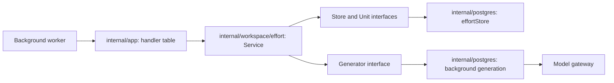

# Foundation Domain Pilot: Workspace Effort

Written by the coordinator on 2026-10-11.
This page records the first business path that left `internal/postgres`. It also gives the pattern for the paths that follow.
It follows the architecture's [target dependencies](../architecture.md#3-target-dependencies) and [migration rules](../architecture.md#9-migration-and-evidence).

## Why This Path

Effort estimation is a complete background path in about 280 lines.
It selects input, calls the model, saves a paid result, validates the output, changes workspace tasks, and recovers after a failure.
The architecture requires a pilot that uses each of these steps.

## Structure

| Package | Contents |
|---|---|
| `internal/workspace/effort` | The start-date rule, the task plan rule, the estimation service, and the interfaces that it needs. It has no SQL and does not import the storage adapter. |
| `internal/postgres/effort.go` | The adapter. It holds the SQL, the job lease, the owner lock, and the transactions. It decides nothing about a task. |
| `internal/app` | Application setup. It constructs the service and holds the worker's handler table. The server and the replay tool use the same table. |

## Paths Outside the Storage Package

| Path | Domain package | Storage adapter | Still in storage |
|---|---|---|---|
| Effort estimation | `internal/workspace/effort` | `internal/postgres/effort.go` | The scheduler query and the plan rule's call from item saves. |
| Topic projects | `internal/workspace/topicproject` | `internal/postgres/topic_projects.go` | The input assembly, the scheduler, and undo. |
| Date review | `internal/currentstate/datereview` | `internal/postgres/date_tidy.go` | The input assembly, the scheduler, and the home page's list of reviewed dates. |
| Project handover | `internal/workspace/projecthandover` | `internal/postgres/project_handover.go` | The input assembly, the evidence check queries, the scheduler, and the reader for the project page. |
| Global handover | `internal/currentstate/handover` | `internal/postgres/status_handover.go` | The input assembly, the scheduler, and the stale rule in SQL. |
| Alias scan | `internal/interpretation/aliasscan` | `internal/postgres/entity_candidates.go` | The batch selection, the name checks of a proposed pair, and the scheduler. |
| Statement comparison | `internal/interpretation/comparison` | `internal/postgres/compare.go` | The batch plan, the write of accepted edges with its eligibility checks, the receipt, the scheduler, and the rejudge path. |
| Entity comparison | `internal/interpretation/comparison` | `internal/postgres/compare_entities.go` | The pair selection, the name and evidence checks, the merge, the receipt, and the scheduler. |
| Organize | `internal/interpretation/organize` | `internal/postgres/organize.go` | The batch selection, the write of labels, groups, dates and rule scope for each statement that is still current, and the scheduler. |
| Attachment parsing | `internal/input/attachment` | `internal/postgres/attachments.go` | The job, the lock of one original, the write of the derived text, and the receipts of paid readings. The archive import is not moved. |
| Extraction | `internal/interpretation/extraction` | `internal/postgres/processing.go` | The reads for the model input, the write of each decided item, the state of the source, and the conversation path of an import. |

The topic project service holds the proposal rules: a match must name a project that the model saw, a new project waits until the model has seen every project, an existing name attaches instead of creating, the user's own name for a project is kept, and four projects are created in one local day at most.
Its input assembly reads memory and clips evidence in one function with SQL. That function stays in storage until memory retrieval has its own interface.

The date review service holds the proposal rules for a remembered date that is not a time to show.
A task or an idea is created and the date is closed in one recorded action, through the workspace item command and the memory date command.
A kept date is recorded too, so that it is not reviewed again unchanged. A date that changed during the call gets no verdict.

The project handover service holds the grounding rules: a sentence is kept only when its evidence was in the input and still exists at the time of the write, a section keeps five sentences, and an output without a grounded sentence leaves the earlier handover in place.
It also holds the preparation rules: no handover for a finished project, no rewrite of a current handover, and one rewrite of a stale handover in one hour at most.

Rules that need no storage can move before their path's orchestration.
The statement comparison rules are in `internal/interpretation/comparison`: reading the model's duplicate and superseded proposals, and following chains of proposals to their final keeper without accepting a cycle.
The comparison job's flow is in the same package. Its write of accepted edges is still in `internal/postgres/compare.go`.

The organize service builds the model input from the batch that storage reads, and it reads the answer.
An item is accepted only when the whole item is valid. A declared group is created only when a statement that is still current uses it.
The package also holds the schedule rule of a recurring date. The schedule reader and the status dates use the same type.
The old code counted declared groups that were "ungrounded". The check could not fail, so the count was always zero. It is removed.

The attachment parser reads an original file by its media type. It holds the limits of a file, the page rule of a PDF file, and the fallback from a model reading to character recognition.
Storage gives it the paid calls through one interface and keeps each paid result with the file. The storage package no longer starts an external processor.
The storage code still holds its transaction open while the parser makes its calls. This order did not change.

The extraction rules are in `internal/interpretation/extraction`: the windows of a long source, the strict reading of the answer, the rules of the source's speaker, the quotation that each item needs, the confirmation level of a statement, and the event time.
The extraction job's flow is in the same package: which sources have nothing to extract, the split of a long source, the model input, and the handling of an answer that is not valid.
`Decide` gives the action for each item: nothing, a task or an idea, a candidate for review, or a statement. Storage applies the action. It no longer decides it.
The conversation path of an import, the reads for the model input, and the writes are still in storage.

## Pattern for the Next Paths

1. Put each business rule in the domain package as a function that needs no database.
2. Give the service the smallest storage interface for its operation. Name each method for the business read or write.
3. Keep one atomic business operation in one storage transaction. The adapter opens the transaction and calls the service's function with a unit interface.
4. The service decides. The unit executes. A unit method must not contain a business condition.
5. Construct the service in `internal/app`. Remove the handler method from the storage type.
6. Write owner contract tests against an in-memory implementation of the interfaces.
7. Keep the existing database tests. Call the service where they called the storage method.
8. Add the package to the domain boundary test in `internal/app/boundaries_test.go`.

## Behavior

The path keeps its behavior. The model input has the same bytes as before.
The saved input record keeps its form, so a result that was paid before the release is applied after it.

| Rule | Location |
|---|---|
| A start date counts back whole workdays from the due day. | `effort.StartDate` |
| A task with a start date has one start reminder at the owner's review time. | `effort.PlanTask` |
| A proposal changes only a task that is unchanged since the snapshot and has no estimate. | `effort.Service.Process` |
| A user estimate is never replaced. | `effort.Service.Process` |
| An unreadable output or a task without a proposal returns the job to the queue with a visible reason. | `effort.Service.Process` |

## Temporary Parts

| Part | Callers | Removal condition |
|---|---|---|
| `Store.GenerateForJob` and `Store.HasSavedResult` in `internal/postgres` | The effort service. | Background coordination owns the queue's failure policy and the saved-result interface. |
| `maintainTaskPlanTx` and the scheduler query `enqueueEffortTx` in `internal/postgres/effort.go` | Item saves and the status scheduler. | The workspace item commands and the scheduler leave the storage package. |
| `workspace.ContentHash` used by storage code | Deputy and secretary input checks. | Those paths leave the storage package. |

## Checks

| Check | Result |
|---|---|
| Owner contracts in `internal/workspace/effort` | Pass without a database, in less than one second. |
| Domain boundary test in `internal/app` | Pass. |
| Phase 3 planning acceptance tests | Pass: user estimate, start dates, start reminder, timeline, paid-result recovery, and stage budgets. |

These acceptance tests ran only with a switch when the pilot was written. The switch is removed, and they run in every complete run.
